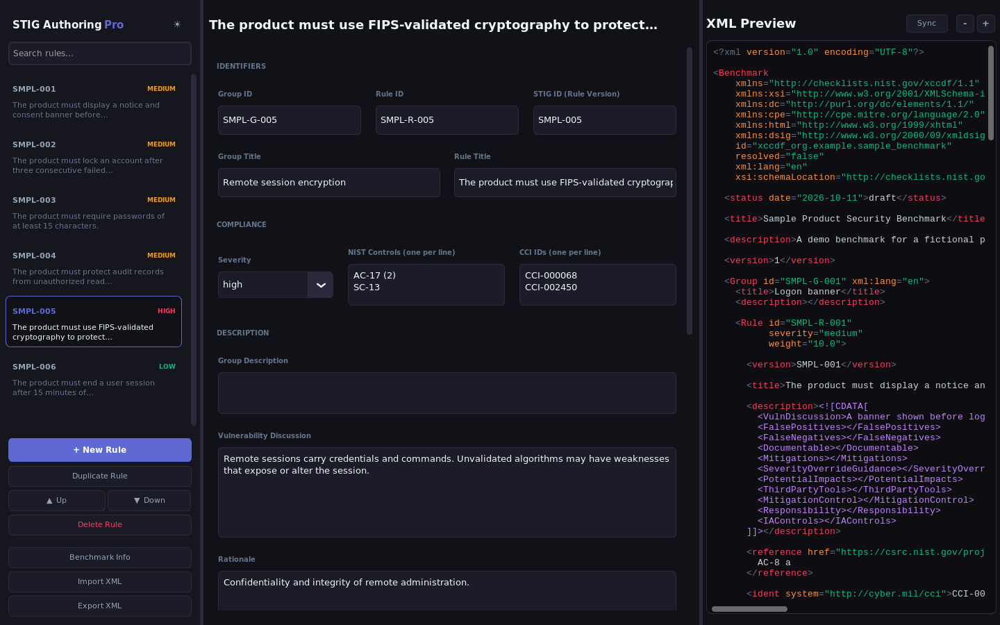
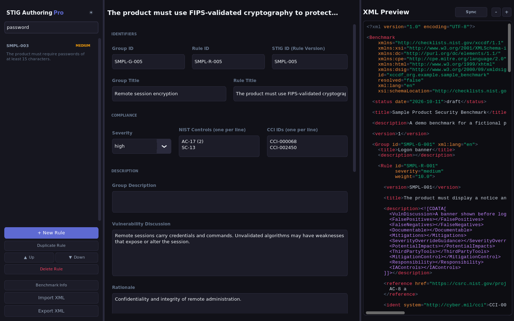
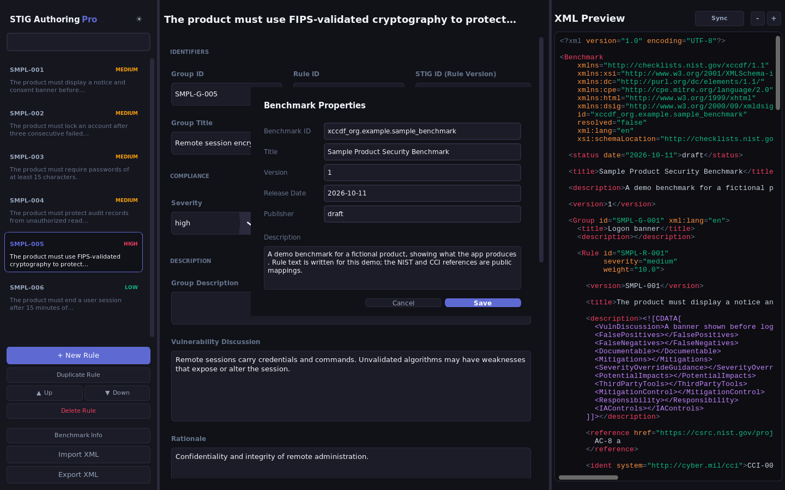
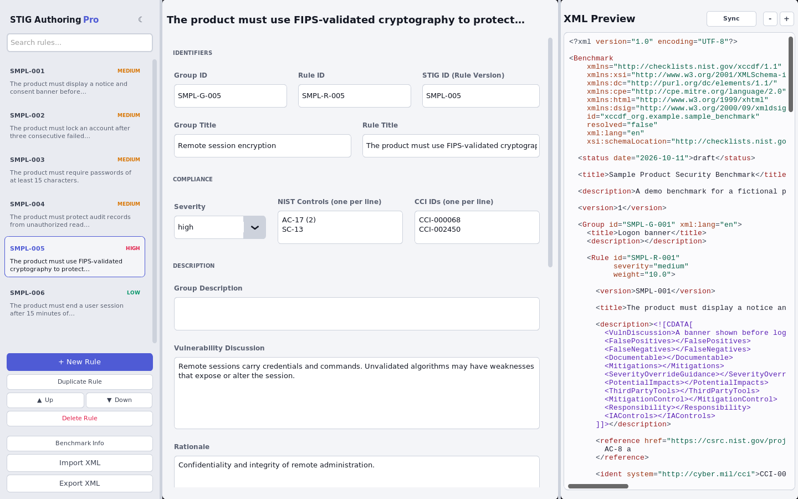

# STIG Authoring Pro

A desktop app for writing STIG benchmarks. You fill in each rule in a form (IDs, severity, NIST controls, CCIs, the vulnerability discussion, the check and the fix) and the app builds XCCDF 1.1 XML in the layout DISA STIGs use, live, in a pane next to the form. It imports existing benchmarks, exports new ones, and ships as a single binary for Linux and Windows.

Writing STIG XML by hand is slow and easy to break: one unescaped `<` in a check and the whole file stops parsing. The form keeps every rule in the same shape, escapes the text for you, and the preview shows exactly what will be written.



## What it does

- **Rule editor.** One form per rule, grouped into identifiers, compliance, description, and audit and fix, plus free-form key/value attributes for anything the schema does not cover.
- **Live XML preview** with syntax highlighting, refreshed every 1.5 seconds as you type.
- **Import and export.** Reads XCCDF benchmarks (including descriptions stored as escaped text or as real subelements, since different tools write them differently) and writes them back out. Text inside CDATA is escaped so a stray `]]>` cannot break the file.
- **Rule management.** Search, add, duplicate, reorder and delete rules. Duplicates get a unique ID automatically.
- **Benchmark properties.** ID, title, description, version, publisher and release date in one dialog. Group and rule IDs left blank are derived from the benchmark ID on export.
- **Autosave and recovery.** Work is saved to `~/.stig_authoring_autosave.xml` every 1.5 seconds. If the app did not close cleanly, it offers to restore that file on the next start, and closing with unexported changes asks first.
- **Dark and light themes,** and zoom for the whole UI or just the XML pane.

`examples/demo-benchmark.xml` is a six-rule benchmark for a fictional product. Import it to see a filled-in file. The rule text is written for the demo; the NIST and CCI references are the public mappings.

## Walkthrough

These are captured from the real app by CI (`scripts/screenshots.py` on a virtual display), so they match the current code.

**1. Pick a rule, edit the form, watch the XML.** The sidebar lists every rule by STIG ID with its severity. The form in the middle is the selected rule; the pane on the right is the full benchmark as it will be exported, refreshed as you type.

**2. Find a rule.** Search filters by STIG ID, rule ID, group ID or title.



**3. Set the benchmark properties.** ID, title, version, release date, publisher and description live in one dialog. Leave a rule's group or rule ID blank and it is derived from the benchmark ID on export.



**4. Export.** Export XML writes the file shown in the preview. Import XML loads any XCCDF benchmark back in for editing.

The light theme, for daytime work:



## Running it

Download the binary for your platform from the latest [release](../../releases).

```bash
# Linux
chmod +x STIG-Authoring-Pro-v*-linux-x86_64
./STIG-Authoring-Pro-v*-linux-x86_64
```

On Windows, run `STIG-Authoring-Pro-v*-windows-x86_64.exe`. It is unsigned, so SmartScreen may ask once.

Or from source, with Python 3 and Tk:

```bash
python3 -m venv venv && source venv/bin/activate
pip install -r requirements.txt
./run.sh            # or: python main.py
```

On Debian or Ubuntu, Tk comes from `sudo apt install python3-tk`.

## How it is built

| File | What it holds |
| --- | --- |
| `models.py` | `STIGRule` and `STIGBenchmark`, plain data classes |
| `engine.py` | XCCDF parsing (namespace stripping, both description formats, multi-value NIST and CCI) and generation |
| `gui.py` | The CustomTkinter app: three resizable panes, theming, zoom, autosave |
| `stig_authoring_pro.spec` | PyInstaller spec for the one-file binary |
| `scripts/screenshots.py`, `.github/workflows/screenshots.yml` | Drive the app on a virtual display and capture the screenshots above |
| `.github/workflows/build-release.yml` | Builds Linux and Windows binaries on every pull request, and publishes them to a GitHub release when a `v*` tag is pushed |

Python, CustomTkinter, ElementTree, PyInstaller, GitHub Actions.
